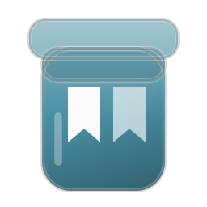
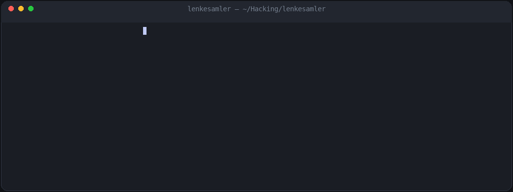

#+title: Lenkesamler
#+author: Josep Bigorra
#+email: jjbigorra@gmail.com
#+language: en
#+options: toc:nil num:nil

[[https://jointhefreeworld.org/ggg/dist/scheme-guile.svg]] [[https://jointhefreeworld.org/ggg/dist/gnu-guix.svg]] [[https://jointhefreeworld.org/ggg/dist/maak.svg]] [[https://jointhefreeworld.org/ggg/dist/license-agpl3+.svg]] [[https://jointhefreeworld.org/ggg/dist/license-fdl13+.svg]]

#+attr_html: :width 160 :alt Lenkesamler logo

*Lenkesamler* (Norwegian for "link collector") is a bookmark manager, sync tool
and digital archive: you keep your bookmarks in *one Scheme file*, and it writes
them out as the file a browser imports, as Markdown, Org, CSV, JSON or XBEL -- or
as a clean listing right in your terminal.

*Bookmarking for the next 50 years.*

/One bookmarks file, three documents: the terminal listing, the bookmarks file Firefox imports, and an Org document./

* Why this exists
:PROPERTIES:
:CUSTOM_ID: why-this-exists
:END:

Browsers come and go. Syncing services shut down, change their pricing, or pivot
to new business models. But your curated bookmarks and knowledge? They are your
personal library, your second brain, and your map of the web.

You shouldn't be locked into one tool or browser. Lenkesamler is built with a
"next 50-years mindset": your bookmarks are a *program you own*, in a language
that will still run when the current browser is a footnote.

By treating bookmarks as pure, programmable data rather than a hidden database
inside a specific browser, you guarantee that *your knowledge base will outlive
the software used to view them*. Define your bookmarks once, and let Lenkesamler
translate them into whatever format you need today, or whatever format gets
invented tomorrow.

#+TOC: headlines 1

* Features
:PROPERTIES:
:CUSTOM_ID: features
:END:

- *One file, every format.* A single ~.scm~ file becomes a browser's bookmarks
  file, Markdown, Org, CSV, JSON, XBEL, or a terminal listing -- with the same
  folders, names and days, and with the tags wherever the format has room for
  them.
- *Bookmarks are code.* Folders are values, links are records, and the whole
  file is Guile Scheme: loop over your environments, read an API, compute a
  name, or ~load~ another file. No DSL to fight, no menu to click.
- *Migration in both directions.* ~--import~ reads the bookmarks file a browser
  exports (Firefox, Chromium, Safari, Edge) and writes it as the bookmarks file
  this program reads. It also reads back the JSON this program writes.
- *A dead-link checker.* ~--check~ asks every link what it answers now and says
  which ones are gone, which have moved, and which were never pages -- and exits
  non-zero when something is broken, so a pipeline can watch your file.
- *Local-first by design.* No account, no service, no database, no telemetry.
  One text file and one command.
- *Reproducible.* Written for GNU Guix; the development shell, the tests and the
  package are the same on every machine.
- *Free software, forever.* AGPL-3.0-or-later for the code, FDL-1.3-or-later for
  this document.

* Ways to install
:PROPERTIES:
:CUSTOM_ID: ways-to-install
:END:

/Four routes to the same 0.0.3, from the most automated to the most manual.  They all build the tag this README documents./

** From the Guix channel
:PROPERTIES:
:CUSTOM_ID: from-the-guix-channel
:END:
*GNU Guix* is the functional package manager this project is developed with: a build is a pure function of its inputs, so the same recipe gives the same result everywhere, and an upgrade that goes wrong can be rolled back.

The jointhefreeworld channel carries ~lenkesamler~ at 0.0.3, so a checkout of the channel is enough — no package definition to write:

#+begin_src shell
git clone https://codeberg.org/jjba23/guix-jointhefreeworld.git
guix install -L ./guix-jointhefreeworld lenkesamler
#+end_src

Add the channel to ~$HOME/.config/guix/channels.scm~ (the channel's README has the four lines) and a plain ~guix install lenkesamler~ keeps working on every later ~guix pull~.

** From the Nix flake
:PROPERTIES:
:CUSTOM_ID: from-the-nix-flake
:END:
*Nix* offers the same declarative, reproducible model with its own language, its own store and a binary cache, and it is a natural fit if the rest of your machine is already described in Nix.

The jointhefreeworld flake builds this project with this repository's own expression, so the package cannot drift from the source:

#+begin_src shell
nix build github:jjba23/nix-jointhefreeworld#lenkesamler
#+end_src

The same attribute is available as an overlay, so ~pkgs.jointhefreeworld.lenkesamler~ works inside a NixOS or home-manager configuration too.

** As a container image
:PROPERTIES:
:CUSTOM_ID: as-a-container-image
:END:
*Podman or Docker* is the route that puts nothing on the host: the ~Dockerfile~ in this repository builds the project in a builder stage and copies only what it installed into a runtime stage, so the image is small and the host keeps its own toolchain untouched.

#+begin_src shell
podman build -t lenkesamler .   # docker build -t lenkesamler . also works
podman run --rm -it lenkesamler
#+end_src

The image's entry point is Guile, with lenkesamler on its load path, which makes it useful for a quick try and for reproducing a bug on a clean system.

** As a distribution package
:PROPERTIES:
:CUSTOM_ID: as-a-distribution-package
:END:
*Debian, openSUSE and Arch* each get the project through their own package manager.  Packaging lives in this repository under ~packaging/~ and is pinned to the same release tag, so the recipes and the sources they build are versioned together.

None of the three archives ships lenkesamler yet, so these are recipes to build rather than packages to install from a mirror:

| Distribution   | Package       | How to build it                                                                     |
|----------------+---------------+-------------------------------------------------------------------------------------|
| Debian, Ubuntu | ~lenkesamler~ | copy ~packaging/debian~ to the repository root, then ~dpkg-buildpackage -us -uc -b~ |
| openSUSE       | ~lenkesamler~ | ~osc build~ with ~packaging/opensuse~                                               |
| Arch           | ~lenkesamler~ | ~makepkg -si~ in ~packaging/arch~                                                   |

Each recipe carries its own dependency list, so a missing library fails the build with its name rather than producing a package that cannot load.

** Which one?
:PROPERTIES:
:CUSTOM_ID: which-one
:END:
- *Guix* if you want the toolchain the project is tested with, and the ability to roll back a bad upgrade.
- *Nix* if the rest of your machine is already declarative; the flake pins nixpkgs and gives you a binary cache.
- *Container* if you only want to try the release, or reproduce a report on a machine that has nothing installed.
- *Distribution package* if you want the project managed by the same tool as the rest of your system, with its licence, manual page and launcher in the usual places.

* Getting started
:PROPERTIES:
:CUSTOM_ID: getting-started
:END:

** Requirements
:PROPERTIES:
:CUSTOM_ID: requirements
:END:

- [[https://guix.gnu.org/][GNU Guix]] (any recent version). The commands below use it, and it is how this
  project is developed and tested.
- Or: Guile 3.0 with [[https://github.com/aconchillo/guile-json][guile-json]] 4, if you would rather run the Scheme
  directly. Everything in the program is plain Guile.
- Nothing else. No database, no server, no account.

** Install with Guix
:PROPERTIES:
:CUSTOM_ID: install-with-guix
:END:

#+begin_src shell
git clone https://codeberg.org/jjba23/lenkesamler
cd lenkesamler
guix package -f ./guix.scm
lenkesamler --help
#+end_src

The GNU Guix package manager installs ~lenkesamler~ into your profile, along with
the Guile sources and the wrapper script that makes the program feel like any
other command-line tool.

If you would rather not install anything, run it straight out of the checkout:

#+begin_src shell
guix shell -f ./guix.scm -- lenkesamler --file ./bookmarks/joe.scm --mode cli
#+end_src

And to be exact about the Guix revision this project is developed against -- the
one pinned in ~channels.scm~ -- use ~guix time-machine~:

#+begin_src shell
guix time-machine --channels=channels.scm -- shell -f guix.scm -- \
     lenkesamler --file ./bookmarks/joe.scm --mode md
#+end_src

** Your first run
:PROPERTIES:
:CUSTOM_ID: your-first-run
:END:

Look at the example bookmarks file, ~bookmarks/joe.scm~, and write your own next
to it -- or edit it in place, it is just a Scheme file.

See what you have, in the terminal:

#+begin_src shell
lenkesamler --file ./bookmarks/joe.scm --mode cli
#+end_src

Write the bookmarks file your browser imports, and open it in your browser:

#+begin_src shell
lenkesamler --file ./bookmarks/joe.scm --destination ./bookmarks.html
#+end_src

That is the whole workflow. Everything else on this page is a choice of format:
add ~--mode markdown~, ~--mode org~, ~--mode csv~, ~--mode json~, ~--mode xbel~,
or ~--mode scheme~ to the same command.

** The development shell
:PROPERTIES:
:CUSTOM_ID: the-development-shell
:END:

Everything the project itself uses -- Guile, guile-json, the [[https://codeberg.org/jjba23/veritas][Veritas]] test
framework, GnuTLS for checking ~https~ links, [[https://codeberg.org/jjba23/maak][Maak]] for the task list -- is in
~manifest.scm~:

#+begin_src shell
guix shell -m manifest.scm
#+end_src

Inside that shell you can run the program from source:

#+begin_src shell
guile -L ./src -c '((@ (lenkesamler main) main))' \
      --file ./bookmarks/joe.scm --mode cli
#+end_src

or through Maak, which is how this project is developed:

#+begin_src shell
maak dev-run   # render ./bookmarks/joe.scm to ./bookmarks-export.html
maak run       # the same, with the installed lenkesamler command
maak test      # the whole test suite
#+end_src

** Without Guix
:PROPERTIES:
:CUSTOM_ID: without-guix
:END:

The program is plain Guile 3.0 plus guile-json 4. Put the sources on the load
path and call ~main~:

#+begin_src shell
guile -L ./src -c '((@ (lenkesamler main) main))' \
      --file ./bookmarks/joe.scm --mode netscape --destination bookmarks.html
#+end_src

The wrapper in ~scripts/lenkesamler~ is a small bash script: it prints the help
text from ~resources/help.txt~ and passes your options through to that same entry
point, so an installed copy behaves exactly like a run from source.

* Your bookmarks file, and its DSL
:PROPERTIES:
:CUSTOM_ID: your-bookmarks-file-and-its-dsl
:END:

Unlike static formats like JSON or YAML, Lenkesamler lets you define your
bookmarks using a full and flexible programming language: Lisp (Guile Scheme).

Why Lisp? Because it provides infinite power. You aren't just writing a list;
you're writing a program. This means you have functions, calculations, API calls,
recursive nesting, macros, and endless extensibility out of the box.

To write your own bookmarks, write some Guile Scheme code in a file called
~bookmarks.scm~ -- or ~whatever.scm~ -- with your bookmark /program/:

Lenkesamler scans for a variable of type list, named ~lenkesamler-bookmarks~, to
load bookmarks from. The file must define the module ~(lenkesamler bookmarks)~
and use this project's prelude, which is where ~dir~ and ~url~ live.

#+begin_src scheme
(define-module (lenkesamler bookmarks)
  #:declarative? #t
  #:use-module (lenkesamler prelude))

(define work-dir
        (dir "Work" work-documents-dir
             (url "app.slack.com/client/T2WXNW2SF5/C08UHE7KM99"
                  #:name "Slack"
                  #:added "2025-04-12")
             (dir "Ops P"
                  (url "grafana.prod-backend.nl"
                       ;; run Scheme code, feel free to
                       ;; make everything dynamic
                       #:name (make-string (+ 20 4 5 (- 90 7)) #\k)))
             (dir "Ops T"
                  (url "grafana.test-backend.nl"
                       #:name "Grafana"))))

(define lenkesamler-bookmarks
        (list work-dir
              (url "codeberg.org/jjba23"
                   #:name "Codeberg")))
#+end_src

The DSL is two forms and a few keywords:

| Form                   | What it makes                                                                 |
|------------------------+-------------------------------------------------------------------------------|
| ~(dir "Work" ...)~     | A folder. It holds links and other folders, as deep as you like.              |
| ~(url "example.org")~  | A bookmark. Written without a name, it is called by its address.              |
| ~#:name "Codeberg"~    | What the bookmark is called.                                                  |
| ~#:added "2025-01-22"~ | The day you saved it, written as ~YYYY-MM-DD~.                                |
| ~#:tags '(dev lisp)~   | A list of symbols. Kept by the terminal, CSV, JSON, Scheme and browser files. |

Note that a link is written the way you would say it: ~codeberg.org/jjba23~ is
reached over ~https://~, while ~mailto:post@example.org~ and ~ftp:~ links keep
the scheme they name.

** Bookmarks are a program
:PROPERTIES:
:CUSTOM_ID: bookmarks-are-a-program
:END:

Modularising your bookmarks becomes trivial: you can split them into multiple
files and ~(load "my-other-bookmarks.scm")~.

You can also easily do dynamic things:

#+begin_src scheme
(map (lambda (k)
       (dir (format #f "Ops ~a" k)
            (url (format #f "grafana.~a-backend.nl" k)
                 #:name "Grafana")
            (url (format #f "argocd.~a-backend.nl" k)
                 #:name "ArgoCD")))
     '(prod test acce))
#+end_src

That list of folders is a folder's worth of bookmarks: the renderers read it as
if you had written each one out.

Need to generate bookmarks from an API? Write a function. Need to output to a
weird, undocumented (or god forbid proprietary) format 10 years from now? Write a
custom exporter in a few lines of Lisp.

The Lenkesamler DSL is flexible and powerful, and based on simple Lisp (Guile
Scheme) allowing for infinite power, recursive nesting and endless extensibility.

* Command-line reference
:PROPERTIES:
:CUSTOM_ID: command-line-reference
:END:

| Option                     | What it does                                                                                |
|----------------------------+---------------------------------------------------------------------------------------------|
| ~-f~, ~--file FILE~        | Read a bookmarks file (this project's Scheme DSL).                                          |
| ~-i~, ~--import FILE~      | Read a bookmarks file from somewhere else: a browser's export, or this project's JSON.      |
| ~-m~, ~--mode MODE~        | What to write. Defaults to ~netscape~, or to ~scheme~ when a run imports.                   |
| ~-d~, ~--destination FILE~ | Write the document to FILE instead of the standard output; the directory is made if needed. |
| ~-c~, ~--check~            | Check every link of the file instead of writing a document.                                 |
| ~-h~, ~--help~             | Show the help text and exit.                                                                |

A run reads exactly one file: ~--file~ or ~--import~, not both.

Every option can also be written out long -- ~--mode json~, ~--check~ -- which
is what the rest of this document does; the short forms above are the ones the
installed command accepts.

The document is written to the file ~--destination~ names, or to the standard
output when no destination is named -- which is what makes
~lenkesamler ... --mode json | jq .~ a run of lenkesamler. What the run says about
itself goes to the error port, so it never lands in the document:

#+begin_src shell
lenkesamler --file ./bookmarks/joe.scm --mode json | jq '.bookmarks[0].name'
#+end_src

* Operation modes
:PROPERTIES:
:CUSTOM_ID: operation-modes
:END:

Supported modes of operation are:

- ~cli~: Command-line / TUI format
- ~csv~: Comma-separated values, a row per bookmark
- ~json~: JSON format
- ~org~: Emacs Org mode format
- ~netscape~ / ~browser~ / ~web~ : Netscape Web Browser Bookmark format
- ~markdown~ / ~md~ / ~commonmark~ : Markdown format
- ~scheme~ / ~scm~ : a bookmarks file, written back as the code you edit
- ~xbel~ : XML Bookmark Exchange Language

The default mode is ~netscape~.

[[https://jointhefreeworld.org/static-assets/lenkesamler/lenkesamler-small.png]]

* Formats
:PROPERTIES:
:CUSTOM_ID: formats
:END:

** CLI
:PROPERTIES:
:CUSTOM_ID: cli
:END:

A simple way to visualize a bookmarks file, right from your terminal.

#+begin_example
[jointhefreeworld]
    jointhefreeworld.org | https://jointhefreeworld.org
    WikiMusic | https://wikimusic.jointhefreeworld.org

[Work]
    Slack | https://app.slack.com/client/ET1XNW2SF5/C08UHE7KM99
    Codeberg added: 2025-01-22  dev  | https://codeberg.org/jjba23

    [Ops T]
        Grafana | https://grafana.test-backend.nl

WhatsApp | https://web.whatsapp.com/
Mastodon | https://mastodon.social
#+end_example

** Browser bookmark file (Netscape)
:PROPERTIES:
:CUSTOM_ID: browser-bookmark-file-netscape
:END:

Netscape legacy -- most web browsers still use it.

The archaic *Netscape Bookmark Format* is a universally recognized, HTML-based
file format used by almost all modern web browsers (like Chrome, Firefox, Safari,
and Edge) to import and export bookmarks.

This format is the definition of "legacy" in software. It is built on weird
non-compliant, semi-valid HTML from the 1990's.

Lenkesamler writes this messy standard perfectly so your browser doesn't have to
guess.

The format uses basic HTML tags to organize links and folder hierarchies:

- ~<!DOCTYPE NETSCAPE-Bookmark-file-1>~ mandatory header that identifies the file type.
- ~<dl>~ definition list: Acts as a container for a group of bookmarks. Nested ~<dl>~ tags represent subfolders.
- ~<dt>~ definition term: Indicates an item in the list, preceding either a folder or a bookmark.
- ~<h3>~ represents a folder name. It often includes an ~ADD_DATE~ attribute (Unix timestamp).
- ~<a>~ Represents the actual bookmark. It contains the ~URL~ (~HREF~) and metadata like ~ADD_DATE~ or the site's favicon (~ICON~).

#+begin_src html
<!DOCTYPE NETSCAPE-Bookmark-file-1>
<TITLE>Bookmarks</TITLE>
<H1>Bookmarks Menu</H1>
<DL>

    <DT><H3 ADD_DATE="1610000000">Work Links</H3>
    <DL>

        <DT><A HREF="https://google.com" ADD_DATE="1610000500">Google</A>
        <DT><A HREF="https://github.com" ADD_DATE="1610000600">GitHub</A>
    </DL>

    <DT><A HREF="https://wikipedia.org" ADD_DATE="1610000700">Wikipedia</A>
</DL>

#+end_src

A name is written as text and not as markup: a bookmark called ~R&D <notes>~ is
escaped, so the browser shows the name you gave it.

** Org mode
:PROPERTIES:
:CUSTOM_ID: org-mode
:END:

A killer-feature for anyone who uses this amazing Emacs mode 🐂.

With Lenkesamler you can easily generate pretty Org mode documents (which further
can be converted easily via Emacs as well to PDF, LaTEX, HTML, etc.).

#+begin_example
  * jointhefreeworld
  - [[https://jointhefreeworld.org][jointhefreeworld.org]]
  - [[https://wikimusic.jointhefreeworld.org][WikiMusic]]

  * Work

  - [[https://app.slack.com/client/T1XNW2SF5/C08UHE7KM99][Slack]]

  ** Documents
  - [[https://vandebron.atlassian.net/wiki/spaces/DIG/pages/95583095586887/REST+standards][🌐 REST standards]]

  * Dev
  - [[https://www.iankduncan.com/engineering/2026-02-09-what-functional-programmers-get-wrong-about-systems/][What functional programmers get wrong about systems]]
#+end_example

The lines are indented here only so that this document stays a document: in the
file Lenkesamler writes, every heading starts at the first column.

** Markdown
:PROPERTIES:
:CUSTOM_ID: markdown
:END:

The popular plain-text format used by modern note-taking apps (Obsidian, Logseq,
Notion, GitHub, etc).

#+begin_example
# Work

- [Slack](https://app.slack.com/client/TWW1XNW2SF5/C08UHE7KM99)
- [Kanban](https://atlassian.net/jira/software/c/projects/PT/boards/223)
- [Onboarding VDB](https://github.com/onboarding/blob/main/onboarding/setup-internal-registries.md)

## Documents

- [🌐 REST standards](https://atlassian.net/wiki/spaces/DIG/pages/95583095586887/REST+standards)
#+end_example

** CSV
:PROPERTIES:
:CUSTOM_ID: csv
:END:

A spreadsheet. One row per bookmark, and the folders a bookmark was written in
carried in the ~folder~ column, outermost first -- empty for a bookmark of the
top level, and ~Work/Ops~ for one inside a folder inside a folder.

A name is written as RFC 4180 says to write a field: quoted when it holds a
comma, a quote or a line break, with the quotes in it doubled. A bookmark named
~R&D, notes~ is a name, not four columns.

#+begin_example
folder,name,url,added,tags
dev,Codeberg,https://codeberg.org/jjba23,2025-01-22,"dev, emacs"
dev/Articles,What functional programmers get wrong,https://www.iankduncan.com/engineering/2026-02-09-what-functional-programmers-get-wrong-about-systems,2026-03-20,
,Mastodon,https://mastodon.social,,
#+end_example

** JSON
:PROPERTIES:
:CUSTOM_ID: json
:END:

The modern standard for data exchange. Browsers like Chromium store bookmarks
internally as JSON. High priority: essential for programmatic use, API
integrations, or piping Lenkesamler output into other CLI tools like ~jq~.

#+begin_src json
{
  "bookmarks": [
    {
      "name": "Work",
      "items": [
        {
          "link": "codeberg.org/jjba23",
          "name": "Codeberg",
          "added": "2025-01-22",
          "tags": [
            "dev"
          ]
        },
        {
          "name": "Documents",
          "items": [
            {
              "link": "vandebron.atlassian.net/wiki/spaces/DIG/pages/95583095586887/REST+standards",
              "name": "🌐 REST standards",
              "added": false,
              "tags": [
                "work"
              ]
            }
          ]
        }
      ]
    }
  ]
}
#+end_src

A link with no day says ~false~ rather than an invented date, and a folder is an
~items~ list. This is also one of the two kinds of file ~--import~ reads, so a
document that left as JSON can come home again.

** XBEL
:PROPERTIES:
:CUSTOM_ID: xbel
:END:

XBEL -- [[https://en.wikipedia.org/wiki/XML_Bookmark_Exchange_Language][XML Bookmark Exchange Language]] -- is the one format here that is a
document rather than a transcription of somebody's screen: an ~<xbel>~ root
holding ~folder~ elements, a folder named by a ~<title>~ child and nesting by its
own nesting, and a ~bookmark~ element carrying its address in ~href~, its name in
a ~<title>~ child, and the day it was added in ~added~.

#+begin_src xml
<?xml version="1.0" encoding="UTF-8"?>
<!DOCTYPE xbel PUBLIC "+//IDN python.org//DTD XML Bookmark Exchange Language 1.0//EN//XML" "http://www.python.org/topics/xml/dtds/xbel-1.0.dtd">
<xbel version="1.0">
  <folder><title>Work</title>
    <bookmark href="https://codeberg.org/jjba23" added="2025-01-22"><title>Codeberg</title></bookmark>
    <folder><title>Ops</title>
      <bookmark href="https://grafana.test-backend.nl"><title>Grafana</title></bookmark>
    </folder>
  </folder>
  <bookmark href="https://mastodon.social"><title>Mastodon</title></bookmark>
</xbel>
#+end_src

It is somewhat niche today, but still read by some open-source browsers (like
Midori or Falkon) and bookmark managers. A name is text and not markup, so a name
holding an ampersand or an angle bracket is written escaped, and a reader of XML
gets back the name it was.

XBEL 1.0 has nowhere to keep tags, so a document written this way holds the
folders, names, addresses and days of a bookmarks file and not its tags. A file
that needs everything is a file for ~json~ or ~scheme~.

* Importing: migrating from a browser
:PROPERTIES:
:CUSTOM_ID: importing-migrating-from-a-browser
:END:

Migration is the other direction of the same files. ~--import~ reads a bookmarks
file from somewhere else -- the browser format above, read instead of written --
and writes it as the bookmarks file this program reads:

#+begin_src shell
lenkesamler --import ./bookmarks-from-firefox.html \
            --destination ./bookmarks/joe.scm
#+end_src

The mode of such a run is ~scheme~ unless ~-m~ names another, so
~--import ... --mode csv~ is a sheet of the bookmarks the browser had. The
folders, the names, the addresses, the day a bookmark was added and the tags
Firefox keeps with one are all kept; what a browser keeps of its own -- its icons,
its cached charsets -- is dropped, because it is not a bookmark.

What this program writes as ~json~ is read back the same way, so a document that
was piped into another program can come home again:

#+begin_src shell
lenkesamler --file ./bookmarks/joe.scm --mode json > joe.json
lenkesamler --import joe.json --destination ./bookmarks/joe.scm
#+end_src

The two kinds of file are told apart by what they hold and not by their names: a
JSON document begins with an object or a list, and a browser's file is the rest.
A file called ~bookmarks.html~ that holds JSON is read as JSON, because a file is
worth migrating whatever it was called.

A link your file writes without a scheme comes back with one
(~https://codeberg.org/jjba23~), because a JSON document says the address a
bookmark leads to and not the shorthand you typed next to it. The folders, the
names, the days and the tags are the ones the document held.

* Checking the links
:PROPERTIES:
:CUSTOM_ID: checking-the-links
:END:

A bookmarks file is a promise about addresses, and the addresses are the part of
it that somebody else can break. ~--check~ asks every one of them what it answers
now:

#+begin_src shell
lenkesamler --file ./bookmarks/joe.scm --check
#+end_src

#+begin_example
checked 3 links
ok       https://codeberg.org/jjba23 (200)
moved    https://mastodon.social (301 -> https://mastodon.social/home)
broken   https://grafana.test-backend.nl (404)
1 ok, 1 moved, 1 broken, 0 error, 0 skipped
#+end_example

A link that answers is ~ok~; one that answers with a redirect is ~moved~ and is
not a failure, because the bookmark still leads somewhere; one that answers with
a refusal (a 404, a 500) is ~broken~; and one that does not answer at all -- no
DNS, no connection, a server that hangs up -- is ~error~. A run with a ~broken~ or
an ~error~ link exits non-zero, so a pipeline can watch a bookmarks file.

What is asked is a ~HEAD~ request -- the status of a page without the page -- and
a server that does not allow one (405 or 501) is asked for the page itself. An
address that is not a page is not a broken link: a ~mailto:~ address, a
~magnet:~ link and the like are reported as ~skipped~ and are not a failure.

Each address is asked once, even when two folders hold the same page, and folders
are walked all the way down. The report goes where the document of a mode would
go: to the standard output, or to ~--destination~ when a run names one. A run that
checks writes no document, so it takes no ~--mode~.

* Development
:PROPERTIES:
:CUSTOM_ID: development
:END:

** Project layout
:PROPERTIES:
:CUSTOM_ID: project-layout
:END:

| Path                          | What lives there                                                                                   |
|-------------------------------+----------------------------------------------------------------------------------------------------|
| ~src/lenkesamler/main.scm~    | Option parsing, reading a file, writing the document.                                              |
| ~src/lenkesamler/prelude.scm~ | The DSL: ~dir~, ~url~, the records, ~get-setting~.                                                 |
| ~src/lenkesamler/renderer/~   | One module per output mode: ~cli~, ~csv~, ~json~, ~markdown~, ~netscape~, ~org~, ~scheme~, ~xbel~. |
| ~src/lenkesamler/importer/~   | Readers for files from elsewhere: a browser's export, JSON.                                        |
| ~src/lenkesamler/checker.scm~ | The link checker and its report.                                                                   |
| ~src/lenkesamler/html.scm~    | The SXML writer used by the browser file and XBEL.                                                 |
| ~test/veritas/unit/~          | The test suite, one spec per module.                                                               |
| ~bookmarks/joe.scm~           | A real bookmarks file, used by the specs and the demo.                                             |
| ~resources/help.txt~          | What ~--help~ prints.                                                                              |
| ~scripts/lenkesamler~         | The installed wrapper script.                                                                      |
| ~maak.scm~                    | Tasks: ~test~, ~dev-run~, ~run~, ~fmt~, ~docs~, ~repl~, ~dev~.                                     |

** Maak tasks
:PROPERTIES:
:CUSTOM_ID: maak-tasks
:END:

[[https://codeberg.org/jjba23/maak][Maak]] organises the development loop. Run it inside ~guix shell -m manifest.scm~,
or as ~guix shell -m manifest.scm -- maak TASK~.

| Task                  | What it does                                                           |
|-----------------------+------------------------------------------------------------------------|
| ~maak test~           | Run the whole test suite.                                              |
| ~maak dev-run~        | Render ~./bookmarks/joe.scm~ to ~./bookmarks-export.html~ from source. |
| ~maak run~            | The same, using the installed ~lenkesamler~ command.                   |
| ~maak fmt~            | Format every Scheme file the way Guix formats its own.                 |
| ~maak docs~           | Build the API documentation in ~doc/~.                                 |
| ~maak repl~           | A Guile REPL with the project on the load path (nREPL).                |
| ~maak dev~            | Re-render on every save (~watchexec~).                                 |
| ~maak package-docker~ | Build a Docker image with ~guix pack~.                                 |

** Tests
:PROPERTIES:
:CUSTOM_ID: tests
:END:

The test suite is written with [[https://codeberg.org/jjba23/veritas][Veritas]], a testing framework for Guile with a
legible, embedded DSL. There is one spec per module under ~test/veritas/unit~:
the DSL and the prelude, every renderer, both importers, the checker, the HTML
writer, and a spec that runs the program itself -- over a real bookmarks file --
and reads both the file ~--destination~ writes and the standard output it prints.

#+begin_src shell
maak test
#+end_src

A spec reads what a function *makes*, not what it happens to print: the XBEL
spec hands its document to an XML parser, the JSON spec reads its document back
as data, the Scheme spec loads the file it wrote, and the checker spec gives the
check its answers instead of asking the internet whether a page is still up.

** Continuous integration
:PROPERTIES:
:CUSTOM_ID: continuous-integration
:END:

Every push to ~trunk~ submits a job to [[https://byggsteg.jointhefreeworld.org][Byggsteg]] from Woodpecker
(~.woodpecker/byggsteg.yaml~). The job runs ~maak-test~ and then ~maak-deploy~,
one task after the other: a commit whose tests fail is never deployed, and the
build reports the failure.

* Contributing
:PROPERTIES:
:CUSTOM_ID: contributing
:END:

You are warmly welcome here -- bug reports, patches, documentation, a new
renderer, a better sentence in this README. Small contributions are as welcome as
large ones, and "I tried it and this was confusing" is a genuinely useful bug
report.

- *Found a bug?* Open an issue on [[https://codeberg.org/jjba23/lenkesamler/issues][Codeberg]]. Say what you ran, what you
  expected, and what happened instead; a bookmarks file that reproduces it is
  worth a thousand words.
- *Have a patch?* Send a pull request on Codeberg. Keep the diff focused, run
  ~maak test~ and ~maak fmt~ first, and add a spec for the behaviour you changed
  -- the suite is the contract, and a bug fixed without a spec comes back.
- *Writing a renderer?* Look at ~src/lenkesamler/renderer/csv.scm~ for the
  smallest one and ~xbel.scm~ for one that builds a document. Register the mode in
  ~main.scm~, add a spec, and say what the format can and cannot keep.
- *Not sure where to start?* The TODO list below is a good place, and asking is
  always fine.

This project adheres to the [[https://jointhefreeworld.org/blog/articles/personal/jointhefreeworld-code-of-conduct/index.html][jointhefreeworld code of conduct]]. In summary, we
foster an inclusive, respectful, and cooperative environment for all contributors
to this free software project. Inspired by the ideals of the GNU Project, we
strive to uphold freedom, equality, and community as guiding principles. We
believe that collaboration in a community of mutual respect is essential to
creating excellent free software.

* License
:PROPERTIES:
:CUSTOM_ID: license
:END:

Lenkesamler and all of its source code are free software, licensed under the GNU
Affero General Public License v3 (or newer at your convenience).

https://www.gnu.org/licenses/agpl-3.0.html

The documentation and examples, including this document, which are provided with
Lenkesamler, are all licensed under the GNU Free Documentation License v1.3 (or
newer at your convenience).

https://www.gnu.org/licenses/fdl-1.3.html

* AI policy
:PROPERTIES:
:CUSTOM_ID: ai-policy
:END:

This project follows the [[https://jointhefreeworld.org/ai-policy/][jointhefreeworld AI policy]].
[[file:AI_POLICY.md][AI_POLICY.md]] holds the short version; the full policy is the link above.

* TODO: formats that will futurely be supported
:PROPERTIES:
:CUSTOM_ID: todo-formats-that-will-futurely-be-supported
:END:

- *Pretty HTML* -- The Netscape format seriously deviates from correct HTML. It
  could be useful to have a simple and a prettified (w/ CSS) valid HTML exporter.
- *SQLite* -- Browsers like Firefox (~places.sqlite~) and Safari use SQLite
  databases, worth investigating, and perhaps generating some ~INSERT~ statements.
- *Nyxt web browser* -- Converting from Scheme to Common Lisp will be a pleasant
  little feature to add, which will help support the Nyxt web browser.
- *OS shortcuts* -- ~.desktop~ (Linux), ~.url~ (Windows), ~.webloc~ (macOS): a
  mode that generates a directory tree on the filesystem populated with these
  shortcut files.

* Thoughts
:PROPERTIES:
:CUSTOM_ID: thoughts
:END:

By treating your bookmarks as pure, programmable data rather than a hidden
database inside a specific browser, you guarantee that *your knowledge base will
outlive the software used to view them*.

Define your bookmarks once in a central file, and let Lenkesamler translate them
into whatever format you need today, or whatever format gets invented tomorrow.

* On reproducibility: why GNU Guix?
:PROPERTIES:
:CUSTOM_ID: on-reproducibility-why-gnu-guix
:END:

A build should never fail because "it worked on my machine." Reliable software
requires explicit, bit-for-bit reproducibility and a functional approach to
package management and system deployment.

#+BEGIN_EXPORT html

#+END_EXPORT

- *Declarative build graphs:* Packages are pure functions of their inputs with no implicit system state.
- *Programmable with Guile:* Full system and package configurations written in [[https://www.gnu.org/software/guile/][Guile Scheme]] rather than rigid DSLs or static files.
- *Time travel:* Rebuild the exact system state from any point in git history using ~guix time-machine~.
- *Atomic operations:* Instantly upgrade or roll back environments without leaving orphaned dependencies or broken states.
- *Unified tooling:* One tool manages development shells, isolated containers, package builds, and full system configurations.

* Support this work
:PROPERTIES:
:CUSTOM_ID: support-this-work
:END:

If you like my work, please support me by [[https://bmc.link/jjbigorra][buying me a cup of coffee ☕]] so I can
continue with a lot of motivation. Stars, issues and patches are appreciated just
as much.
